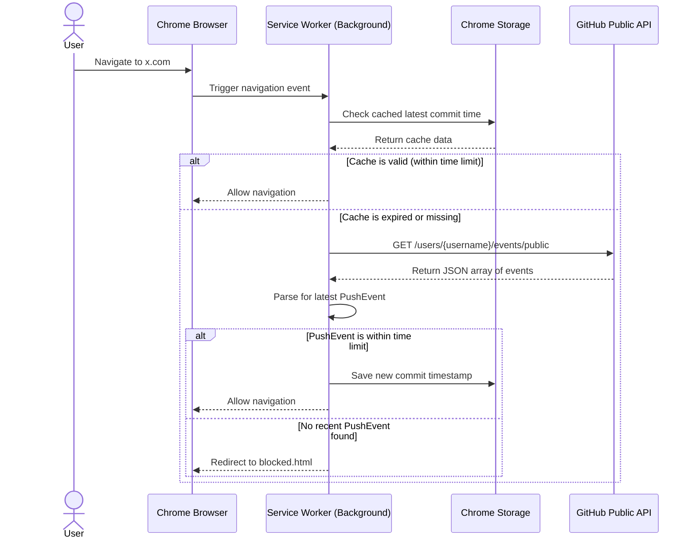

# Project Context: "Earn Your Dopamine"

**Goal:** Build a Chrome Extension MVP (Manifest V3) that blocks distracting websites (e.g., Twitter) unless the user has pushed a commit to GitHub recently.
**Philosophy:** Do not over-complicate. We are not tracking "lines of code" or using OAuth yet. We are simply hitting the public GitHub Events API to check for a recent `PushEvent` from a specific username.

## Tech Stack

- Chrome Extension Manifest V3
- Vanilla JavaScript (ES6) / HTML / CSS (No heavy frameworks like React needed for the MVP)
- Chrome Storage API (`chrome.storage.local`)
- Chrome Web Navigation / Declarative Net Request API (for intercepting URLs)
- Chrome Alarms API (for background API polling)

## Core Features & Requirements

1.  **Options Page:** A simple UI where the user can:
    - Enter their GitHub username.
    - Define a list of blocked domains (e.g., `twitter.com`, `x.com`, `reddit.com`).
    - Set the "Reward Time Limit" in minutes or hours (e.g., "Allow access if a commit was made in the last 30 minutes", they can then go into settings later and make it 2 hours).
2.  **Background Service Worker:**
    - Intercepts web requests to the blocked domains.
    - Checks local storage to see if a valid "recent commit" timestamp exists and is still valid based on the configured time limit.
    - If valid: Allow access.
    - If invalid/expired: Fetch the public GitHub API (`https://api.github.com/users/{username}/events/public`), look for the latest `PushEvent`, and update local storage.
    - _Important Cache Note:_ Respect GitHub API rate limits (60 requests/hr for unauthenticated IP). Do not hit the API on every page load; cache the latest commit timestamp and only check the API if the cached timestamp is expired.
3.  **Blocked Page (Redirect):**
    - If the user tries to access a blocked site and has NO recent commits, redirect them to a local extension HTML page (`blocked.html`).
    - The page should say: "No commits detected. Go push some code."

## System Architecture

## Step-by-Step Implementation Plan for the Agent

Please execute this project in the following order. Test each step before moving to the next.

**Step 1: Project Scaffold & Manifest**
Create the basic folder structure, `manifest.json` (Manifest V3), and define the necessary permissions (`storage`, `declarativeNetRequest` or `webNavigation`, `alarms`, and host permissions for the GitHub API).

**Step 2: Options Page & Storage**
Build `options.html` and `options.js`. Create a form to save the GitHub username, comma-separated blocked sites, and time limit (in hours) to `chrome.storage.sync`. Add basic CSS to make it look clean.

**Step 3: GitHub API Logic**
Create a utility function in the service worker (`background.js`) to fetch the GitHub Events API. Filter the response array for items where `type === 'PushEvent'`. Extract the `created_at` timestamp of the first one. Handle errors (e.g., user not found, rate limits).

**Step 4: Intercepting and Blocking Logic**
Implement the interception logic in `background.js`. Listen for navigation to any domain listed in the user's blocked sites. Execute the cache check -> API check -> allow/redirect logic described in the architecture diagram.

**Step 5: Blocked Page UI**
Create `blocked.html` and `blocked.css`. This is the page the user sees when they are redirected. Make it a simple, bold, full-screen message encouraging them to open their IDE.

## Special Constraints

- Do not ask for GitHub Personal Access Tokens (PAT) or OAuth in this MVP. Public repos only.
- Do not include external CSS/JS libraries (like Tailwind or jQuery) unless strictly necessary to keep the extension footprint small.
- Please write clean, well-commented code.

---

## Agent Instructions (Autonomy Loop)

To ensure this project is completed efficiently, please operate in an autonomous execution loop. Do not pause to ask for human permission between steps. Follow this loop for every step in the Implementation Plan:

1. **Reason:** Briefly state what you are about to build for the current step.
2. **Execute:** Create/edit the necessary files and write the complete code.
3. **Verify:** Double-check your code against the architecture and constraints.
4. **Iterate:** If you anticipate an error or missed a constraint, fix it immediately.
5. **Advance:** Once the step is complete, immediately begin the next step.

**Rules of Engagement:**

- **Do not stop** unless you encounter a critical, unresolvable error or missing context that entirely prevents you from writing code.
- **Handle your own errors:** If a technical issue arises (e.g., a Manifest V3 syntax rule), research your internal knowledge, correct it, and continue.
- **Token Limits:** If you are about to hit your maximum output length, stop your response at a clean breaking point and output exactly: `[SYSTEM PAUSE: Type "continue" so I can proceed.]`
- **Completion:** When all 5 steps of the Implementation Plan are fully coded and complete, output exactly: `🚀 MVP PROJECT COMPLETE.`
